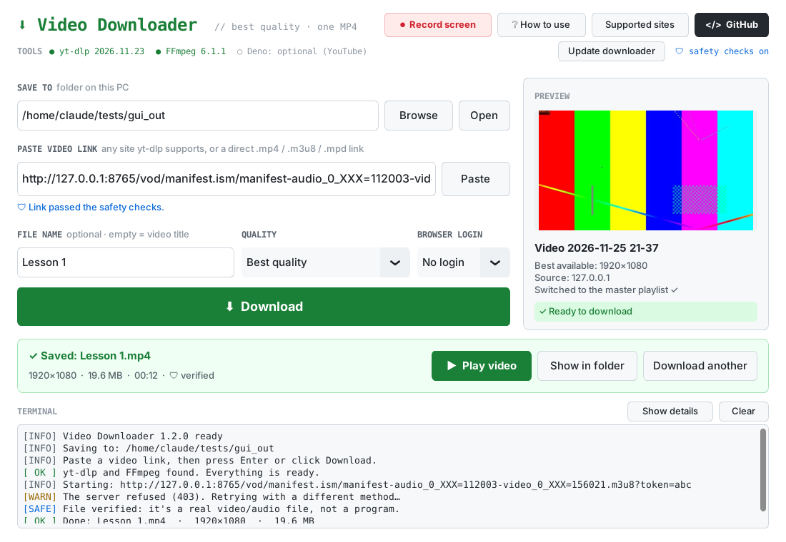
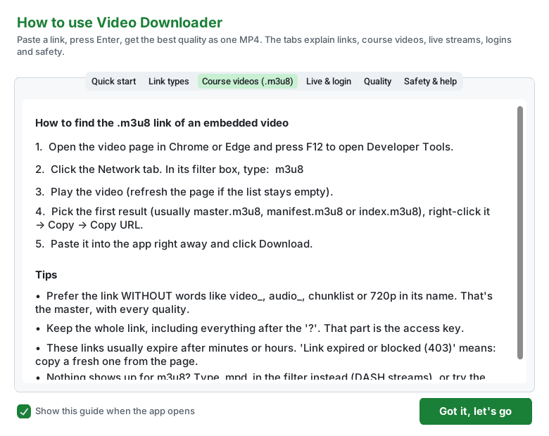
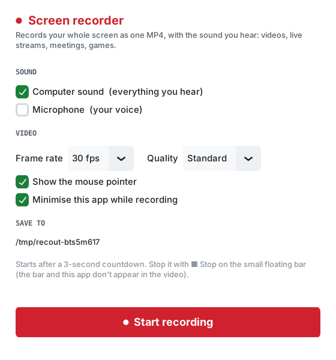
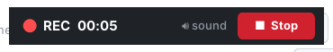
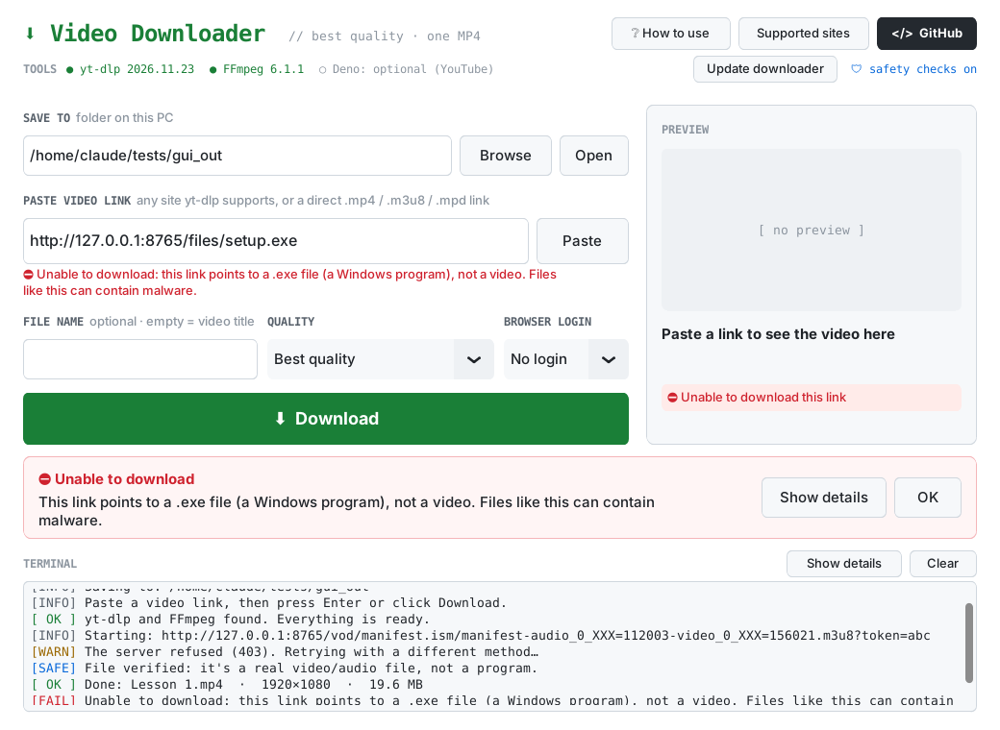

# ⬇ Video Downloader

A Windows desktop app: **paste a video link, press Enter, get the best quality as one MP4**, or **record your screen with sound, mic and camera**.
It's built on [yt-dlp](https://github.com/yt-dlp/yt-dlp) and [FFmpeg](https://ffmpeg.org/), with a clean white interface, a built-in "How to use" guide, and safety checks on every download.

**[⬇ Download VideoDownloader.exe (latest release)](https://github.com/souldraft/video-downloader/releases/latest)** · [Website](https://souldraft.github.io/video-downloader/)

---

## Download (Windows 10/11, 64-bit)

1. Go to **[Releases](https://github.com/souldraft/video-downloader/releases/latest)** and download **`VideoDownloader.exe`** (about 50 MB, one file, nothing to install).
2. Put it in **its own folder**, for example `Documents\Video Downloader`. The app keeps its settings (`settings.json`) and a `tools` folder next to the .exe.
3. Double-click it. Windows may show a blue **"Windows protected your PC"** box because the app isn't code-signed yet: click **More info** → **Run anyway**.
4. On first launch the app checks for **yt-dlp** and **FFmpeg** and offers to install them for you (winget, or an official GitHub download as backup).

> From v2.1.0 the app tells you when there's a newer version (a green **⬆ New version** button at the top; it checks GitHub once a day and you can turn it off under **TOOLS ▾**).

> Want to check the file? Each release lists the **SHA-256** of the .exe. In PowerShell: `Get-FileHash .\VideoDownloader.exe -Algorithm SHA256`

---

## Free, with optional donations

**Every feature is free**, including the screen recorder, the camera bubble / cutout and pause. There's no paid version, trial or account.

If the app is useful to you, you can **donate ₹20 to ₹300 by UPI** (GPay, PhonePe, Paytm…): click **☕ Tip the developer** in the app, or use the [donate box on the website](https://souldraft.github.io/video-downloader/#donate), tick the box to confirm it's a voluntary gift, then scan the QR code. Donations don't buy or unlock anything.

---

## What it does

| | |
|---|---|
| **Any site yt-dlp supports** | YouTube, Vimeo, Facebook, Instagram, X, Reddit, TikTok, Dailymotion and [1,700+ more](https://github.com/yt-dlp/yt-dlp/blob/master/supportedsites.md) |
| **Streaming links** | `.m3u8` (HLS), `.mpd` (DASH) and direct `.mp4` / `.webm` links: course websites and embedded players |
| **Best quality, one file** | Highest resolution plus best audio, merged into one MP4 that plays everywhere |
| **Fixes blurry links** | Detects low-quality "variant" playlists and switches to the master playlist automatically |
| **Signed / token links** | Keeps the `?token=…` part and passes it on, so course links don't fail with 403 |
| **Logins** | "Browser login" uses your browser's cookies for sites that need you logged in |
| **Screen recorder** | Records the full screen as one MP4 with PC sound and/or your microphone, kept in sync, with an optional camera bubble or background-free cutout, and pause/resume |
| **Safety** | Blocks dangerous links, checks every file is real video, and scans it with Microsoft Defender |
| **Easy setup** | Installs yt-dlp and FFmpeg for you if they're missing (winget, or a GitHub download as backup) |

---

## How to use

1. **SAVE TO**: pick the folder for your videos (asked once on first launch, then remembered).
2. **PASTE VIDEO LINK**: copy a link and click **Paste**. The preview shows the title, the best resolution and the length.
3. Optional: type a **FILE NAME** and choose a **QUALITY** (Best, Up to 1080p, Up to 720p, Most compatible H.264, Audio only MP3).
4. Press **Enter** or click **Download**. When it's finished: **▶ Play video**, **Show in folder** or **Download another**.

A **How to use** guide opens with the app (untick "Show this guide when the app opens" to stop it). You can reopen it with the **❔ How to use** button.

### Screen recorder (full screen + sound + camera)
1. Click **⏺ Record screen** at the top. A compact dark bar appears at the top of your screen (like the Windows Snipping Tool).
2. Switch on what you want on the small dark bar (icons only; hover an icon to see its name): **microphone**, **PC sound** (everything you hear) and **camera** (your face, like streamers). Lit = on. The **mic icon shows your voice live**: grey when it's quiet, green when you speak, red after a few seconds of non-stop talking. **▾ next to the camera** picks **Bubble** or **Cutout (no background)** and the size (Small to Extra large). **⚙** has 30/60 fps, Standard/High quality, the mouse pointer and minimise-while-recording.
3. Click **● Start**. After a 3-second countdown (**✕ Cancel** stops it) the timer runs.
4. The small **pause** icon next to Stop pauses (that part is left out of the video). **▶** goes on. Click **■ Stop**. You get `Screen Recording YYYY-MM-DD HH-MM-SS.mp4` in your SAVE TO folder, with **Play video** / **Show in folder**.

 

*Screenshots are from v1.2. The v2.0 recorder bar is smaller, dark and icons-only; new screenshots are coming.*

- The bar and the app are **hidden from the recording** (Windows 10 version 2004 or newer). The camera bubble **is** recorded.
- **Cutout (no background)** (▾ next to the camera) removes your background so only you show, like streamers, at the camera size you pick (Small to Extra large). It uses Google's MediaPipe selfie segmentation model (`selfie_segmentation.onnx`, 0.5 MB, Apache 2.0, see `selfie_segmentation.LICENSE.txt`) through `onnxruntime`, about 4 ms per frame on the CPU. Best with good light and a plain wall behind you.
- The camera is read through FFmpeg (DirectShow), so there's nothing extra to install. If it won't start, close other apps that use it and check Settings > Privacy & security > Camera > "Let desktop apps access your camera".
- If the mic icon stays grey while you talk, the app warns you. Check the mute key on your keyboard, Settings > System > Sound > Input, and Settings > Privacy & security > Microphone.
- Encoding uses your **graphics card** (Intel Quick Sync, NVIDIA NVENC or AMD AMF) when available, with the CPU (x264) as fallback. It captures with Windows Desktop Duplication (`ddagrab`), with `gdigrab` as fallback. The first recording checks what your PC supports.
- **Sync:** FFmpeg records the picture and Python records the sound (WASAPI loopback via `soundcard`); both are stamped with the system clock and lined up when saving. In testing, sound and picture stayed within ±40 ms, including after an audio dropout and across pauses.
- DRM players (Netflix, Prime Video…) show black in any recording; that's Windows' copy protection. Tell people before recording a call.

### Finding the `.m3u8` link of a course / embedded video
1. Open the video page in Chrome or Edge and press **F12**.
2. Open the **Network** tab and type `m3u8` in the filter box.
3. Play the video (refresh if the list stays empty).
4. Right-click the first result (usually `master.m3u8`, `manifest.m3u8` or `index.m3u8`) → **Copy** → **Copy URL**.
5. Paste it into the app right away. These links often expire; if you get **"Link expired or blocked (403)"**, copy a fresh one.

Tip: choose the link **without** `video_`, `audio_`, `chunklist` or `720p` in its name. That's the master with every quality. If you paste a variant anyway, the app tries to find the master for you.

### Live streams, logins, limits
- **Recorded lives / replays**: paste the replay link like any video. **Currently live**: download the replay after it ends.
- **Sites that need a login**: log in with your browser (Firefox works best) and pick it under **BROWSER LOGIN**.
- **YouTube** needs [Deno](https://deno.com/) for full quality. The app shows an **Install Deno** button when you paste a YouTube link.
- **DRM-protected services** (Netflix, Prime Video, JioHotstar, Disney+, Spotify) can't be downloaded, and the app doesn't try.

---

## Use it responsibly

Only download or record what you're allowed to: your own videos, content the owner lets you save, or material your local law permits. Respect each site's terms and other people's copyright and privacy. You're responsible for what you download and record with this app.

---

## Safety

1. **Link check before anything runs**: only `http`/`https`. Links to programs, scripts and archives (`.exe .msi .bat .ps1 .vbs .scr .dll .zip .rar .7z .iso .apk …`) are refused, including when hidden in a parameter (`?file=setup.exe`). Phishing-style `site.com@evil.com` links are blocked; lookalike (punycode) domains and bare IP addresses get a warning.
2. **yt-dlp runs locked down**: no shell, `--ignore-config` (no config file can inject commands), `--no-plugin-dirs`, and `--` before the URL so pasted text can never become an option.
3. **Direct links are sniffed first** (first 1 KB). A Windows program, archive, script or web page disguised as a video is refused before downloading.
4. **Every finished file is verified** (MP4/MP3 signature + ffprobe must find real video/audio). If not, it's deleted.
5. **Microsoft Defender scan** of every finished file. If a threat is found, the file is deleted.
6. **Play video** only opens media files, never programs.

> Honest limit: these checks block the common tricks, but no app can promise to catch every possible threat.

---

## Troubleshooting

| Message / problem | Fix |
|---|---|
| "Windows protected your PC" when opening the .exe | The app isn't code-signed yet. Click **More info** → **Run anyway** |
| Link expired or blocked (403) | Copy a fresh link from the page (stream links expire) |
| A site stopped working | Click **Update downloader** (updates yt-dlp) |
| "yt-dlp and FFmpeg are missing" | Click **Install automatically** in the yellow bar, or run `winget install --id yt-dlp.yt-dlp -e` and `winget install --id Gyan.FFmpeg -e` |
| Chrome/Edge login error | Close the browser completely, or use Firefox under **BROWSER LOGIN** |
| Video won't play on an old TV/phone | Choose **Most compatible (H.264)** |
| Recording has no PC sound | Check that your speakers/headphones are the default output in Windows Sound settings, and that the PC sound icon on the bar is lit |
| Recording has no mic sound | See the mic note in the recorder section above |
| Recording looks choppy | Choose **30 fps** and **Standard** quality under **⚙** |
| Defender flags `VideoDownloader.exe` | A known false alarm with PyInstaller apps. Download only from this repo's Releases page and compare the SHA-256 |
| Anything else | Click **💬 Support** in the app (it adds your support ID and, if you want, a screenshot), or email **vteam732@gmail.com** |

---

## Support

- In the app: **💬 Support** (top right). Pick a subject, describe the problem, optionally attach a screenshot.
- Email: **vteam732@gmail.com**. Please include your **support ID** (shown at the top of the app; click it to copy).

---

## Build from source

The source is here so you can see how the app works. You can build it for your own personal use (see [LICENSE](LICENSE)).

1. Download or clone this repo, then double-click **`build.bat`**. It finds or installs Python, builds `VideoDownloader.exe`, installs it to `%LOCALAPPDATA%\Programs\VideoDownloader`, and creates **Desktop** and **Start menu** shortcuts. The first run takes 2–5 minutes.
2. `build.bat admin` builds a version that always runs as Administrator. `uninstall.bat` removes the app, its settings and its tools folder; your videos are not touched.
3. To run without building: `pip install customtkinter pillow soundcard segno onnxruntime`, then `python VideoDownloader.py`.

Self-test: `python VideoDownloader.py --selftest`

| File | Purpose |
|---|---|
| `VideoDownloader.py` | The whole app in one file: download engine, screen recorder, camera, safety layer, tool installer, GUI |
| `build.bat` / `uninstall.bat` | One-click build + install + shortcuts / remove |
| `icon.ico` | App icon |
| `selfie_segmentation.onnx` | Background-removal model for the camera cutout (Apache 2.0, licence in `selfie_segmentation.LICENSE.txt`) |
| `support-server/` | The small Google Apps Script that turns the in-app Support form into an email |
| `scripts/make_donate_qr.py` | Makes the website's donation QR codes for a UPI ID (same code as the app) |
| `CLAUDE_CODE_PROMPT.md` | Technical specification for working on the app with Claude Code |
| `CHANGELOG.md` | What changed in each version |
| `docs/` | The website (GitHub Pages) and screenshots |

**Tech:** Python 3.12 · customtkinter · Pillow · soundcard · NumPy · segno · ONNX Runtime · PyInstaller · yt-dlp · FFmpeg · (optional) Deno. Licences: [THIRD_PARTY_NOTICES.md](THIRD_PARTY_NOTICES.md)

---

## About

Made by **Shiva Kaja** ([souldraft](https://github.com/souldraft)), written with **Claude**. Every version was tested before release with real downloads (a local HLS server that mimics signed course links, with variant/master playlists and access tokens), fake malware files, real screen recordings with a flash-and-beep sync test, window screenshots of each state, and a PyInstaller build. See [CHANGELOG.md](CHANGELOG.md).

© 2026 Shiva Kaja. All rights reserved. See [LICENSE](LICENSE).
